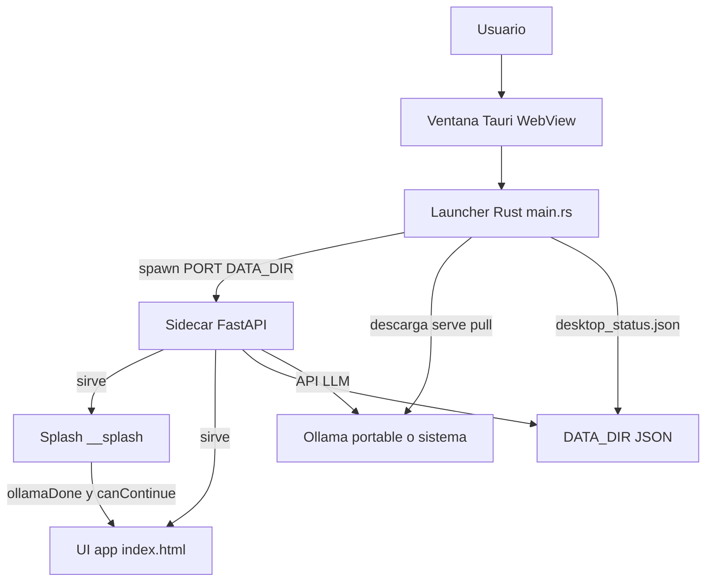

# Manual técnico — SmartCaja

Documento para **desarrolladores, soporte técnico e integradores** de la Cámara Colombiana de Comercio Electrónico (CCCE).  
No sustituye un manual de usuario final.

**Aplicación:** SmartCaja · **Versión documentada:** 2.0.2 · **Identificador de bundle:** `co.org.ccce.smartcaja`

---

## 1. Propósito y alcance

**SmartCaja** es la aplicación de **flujo de caja con IA local** de la CCCE para PYMEs en Colombia. Opera 100 % en el equipo del usuario: entrevista financiera, proyección de caja, escenarios, métricas y exportación, con modelos Llama vía Ollama.

El producto se entrega como **aplicación de escritorio nativa** (Tauri):

| Plataforma | Artefacto | Arquitecturas |
|------------|-----------|---------------|
| **Windows** | MSI y `*-setup.exe` (NSIS) | x64 |
| **macOS** | DMG firmado | **Apple Silicon** (`aarch64`) e **Intel** (`x86_64`) |

También puede levantarse el backend en desarrollo con Python (`server/app.py`) para QA e integración, sin empaquetar el shell de escritorio.

Alcance de este manual: arquitectura, datos, marco financiero colombiano, IA, API, build multiplataforma y troubleshooting.  
Fuera de alcance: guía de uso paso a paso para el dueño de la PYME.

---

## 2. Arquitectura



### Arranque de la aplicación de escritorio (Windows y macOS)

El mismo launcher Rust aplica en ambas plataformas; cambia el nombre del sidecar y la carpeta de datos del SO.

1. Elige un puerto libre (preferencia `7860`–`7863`).
2. Lanza el sidecar FastAPI empaquetado con PyInstaller (`backend` / `backend.exe`) con `PORT`, `DATA_DIR` y `OLLAMA_*`.
3. Cuando `/api/health` responde, navega a `http://127.0.0.1:<puerto>/__splash/`.
4. En paralelo, prepara Ollama: API ya sana en `:11434`, portable previo en el data dir, binario en PATH, o descarga del archivo oficial del SO/arquitectura.
5. Hace *pull* del modelo según RAM; solo entonces marca `ollamaDone` y el splash abre la UI (`/`).
6. Al cerrar la ventana, detiene el sidecar y, si esta app arrancó Ollama, también ese proceso.

### Desarrollo local (sin instalador)

```bash
python server/app.py --port 7860
```

FastAPI sirve la UI en `/` y la API en `/api/*`. Los datos viven en `<repo>/data/` salvo que se defina `DATA_DIR` absoluto.

---

## 3. Stack tecnológico

| Capa | Tecnología |
|------|------------|
| Shell de escritorio | Tauri 2 + Rust (`desktop/src-tauri`) |
| Backend | FastAPI + Uvicorn (Python **3.12** recomendado; 3.10–3.12 soportado) |
| Empaquetado sidecar | PyInstaller (`desktop/backend/backend.spec`) |
| Frontend | HTML/CSS/JS vanilla, Chart.js, tipografía DM Sans |
| IA local | Ollama + modelos Meta Llama |
| Simulación | NumPy, motor en `server/financial_engine/` |
| Persistencia | JSON en disco |
| Exportación | openpyxl (Excel), CSV |
| Distribución macOS | DMG + firma Developer ID (certificado Apple) |

**Python 3.13/3.14 no se usa para empaquetar:** `numpy 1.26.4` no tiene wheels y el build falla.

---

## 4. Mapa del repositorio

```
SmartCaja/
├── app/                      # UI web (index.html, app.js, logos CCCE)
├── server/
│   ├── app.py                # FastAPI principal + endpoints V1 + desktop
│   ├── advanced_endpoints.py # Router /api/v2 (motor financiero)
│   ├── interview_manager.py  # Entrevista inteligente
│   ├── market_research.py    # Contexto de mercado / inflación
│   └── financial_engine/     # core, metrics, monte_carlo
├── defaults/                 # agents.json y prompts de sistema/skills
├── desktop/
│   ├── smartsuite.config.json
│   ├── scripts/
│   │   ├── configure.mjs
│   │   ├── build-backend.ps1   # Windows
│   │   ├── build-backend.sh    # macOS / Linux
│   │   └── tauri-build.mjs
│   ├── brand/                # Kit visual CCCE + splash.template.html
│   ├── ui/                   # Splash del instalador
│   └── src-tauri/            # Rust, iconos, sidecar binaries/
├── tests/
├── .github/workflows/
│   └── macos-installer.yml   # DMG Apple Silicon + Intel
└── requirements*.txt
```

---

## 5. Flujos funcionales

### 5.1 Empresas

- Alta vía `POST /api/companies` (país/moneda por defecto: Colombia / COP; campo **NIT**).
- Datos en `DATA_DIR/companies/<id>/` (`company.json`, `cashflow.json`, etc.).

### 5.2 Entrevista financiera

- Agente conversacional (`InterviewManager`) cubre áreas priorizadas (ingresos, costos, impuestos, nómina, etc.).
- Endpoint principal: `POST /api/chat/interview` (V1) y `POST /api/v2/chat/interview`.
- Progreso: `GET .../interview-progress`.

### 5.3 Generación de cashflow

- V1: `POST /api/companies/{id}/generate-cashflow` + progreso por `task_id`.
- V2: generación mes a mes con estacionalidad, notificaciones y motor modular (`/api/v2/...`).

### 5.4 Escenarios y Monte Carlo

- Simulación clásica: `POST /api/companies/{id}/simulate`.
- V2: Monte Carlo, sensibilidad, comparación y versionado de cashflow (`/api/v2/companies/{id}/monte-carlo`, `sensitivity`, `cashflow-versions`, etc.).

### 5.5 Exportación

- Excel/CSV de empresa o escenario: `/api/companies/{id}/export/*`, `/api/scenarios/{id}/export/*`.
- Backup completo: `/api/export` e `/api/import`.

---

## 6. Marco financiero Colombia (2026)

La aplicación modela la realidad tributaria y laboral colombiana en UI (`app/app.js`), entrevista (`interview_manager.py`), defaults y prompts.

| Tema | Criterio en la aplicación |
|------|---------------------------|
| Moneda / locale | COP, `es-CO` |
| Identificación | NIT / RUT; autoridad DIAN |
| IVA | 19 % general; 5 % diferencial |
| Renta sociedades | 35 % régimen ordinario |
| Alternativa PYME | Régimen Simple (tarifa sobre ingresos) |
| Otros | ICA municipal, retenciones, GMF 4×1000 |
| SMMLV 2026 | $1.750.905 |
| UVT 2026 | $52.374 |
| Auxilio transporte | $249.095 (si aplica ≤ 2 SMMLV) |
| Nómina en UI | `colombiaPayroll()`: salud/pensión 4 %, solidaridad, retefuente estimada, costo empresa, exoneración PYME |
| Estacionalidad | Semana Santa, Día de la Madre, Cyberlunes/HotSale, Navidad, vacaciones de mitad de año |

La calculadora de nómina es **educativa**: no reemplaza una nómina oficial ni un software de liquidación.

Identidad visual CCCE: azul `#173A7A`, rojo `#CE1126`, acento SmartCaja `#F4C10E`.

---

## 7. Persistencia

### Directorios por plataforma

| Contexto | Ruta de datos |
|----------|----------------|
| Windows (instalador) | `%APPDATA%\SmartCaja\` |
| macOS (instalador) | `~/Library/Application Support/SmartCaja/` |
| Linux (desktop) | `~/.local/share/SmartCaja/` (o `$XDG_DATA_HOME`) |
| Desarrollo | `<repo>/data/` salvo `DATA_DIR` absoluto |

El launcher Tauri pasa `DATA_DIR` al sidecar. En binario empaquetado, si no hay env válido, `server/app.py` resuelve la carpeta de usuario `SmartCaja` según el SO.

### Contenido típico de `DATA_DIR`

```
SmartCaja/
├── companies/<id>/
├── sessions/
├── scenarios/
├── checkpoints/
├── exports/
├── agents/
├── prompts/
├── audit/
├── desktop_status.json      # Estado del splash (escrito por Tauri)
├── retry_ollama.flag        # Pedido de reintento desde /api/desktop-retry
├── ollama/
│   ├── runtime/             # Binario portable
│   ├── models/              # OLLAMA_MODELS
│   ├── download/
│   ├── active_model.txt
│   └── active_profile.json
└── logs/ollama.log          # Log unificado launcher + sidecar
```

---

## 8. IA y hardware

### Política de acceso (escritorio)

Definida en `desktop/smartsuite.config.json` → `access` y leída por Rust vía `appconfig.json`:

| RAM medida | Comportamiento |
|------------|----------------|
| &lt; 7 GB | Fase `blocked` (no continúa el bootstrap de Ollama) |
| 7–13 GB | Advertencia de rendimiento; modelo liviano/estándar |
| ≥ 13 GB | Uso normal |

Override de laboratorio: `SMARTSUITE_ALLOW_LOW_RAM` o `SMARTCAJA_ALLOW_LOW_RAM` = `1` / `true`.

### Tiers de modelo

| Tier | maxRamGb | Modelo |
|------|----------|--------|
| Liviano | 7 | `llama3.2:1b` |
| Estándar | 13 | `llama3.2:3b` |
| Completo | 24 | `llama3.2:3b` |
| Máximo | 0 (sin tope) | `llama3.1:8b` |

SmartCaja no descarga modelos adicionales (`extraModels` vacío).

### Primer arranque Ollama

Orden en `ensure_ollama_api` (`desktop/src-tauri/src/main.rs`):

1. Si ya hay API sana en `127.0.0.1:11434` → reutilizar (no se detiene al cerrar).
2. Si existe portable en `ollama/runtime` → arrancar `serve`.
3. Si `ollama` está en PATH → arrancar y registrar PID propio.
4. Si no → descargar el paquete oficial según plataforma:
   - **Windows x64:** zip `ollama-windows-amd64`
   - **macOS (Apple Silicon e Intel):** tgz `ollama-darwin` (el mismo archivo portable; el binario nativo se resuelve en runtime)
5. Descarga con **curl**, en Windows también **PowerShell**, y por último **ureq** con TLS.
6. Extraer, `serve`, *pull* del modelo del perfil.

Si la descarga o el *pull* fallan: fase `warning`, **no** se abre la UI; el splash muestra **Reintentar descarga** (`retry_ollama` / `POST /api/desktop-retry`).

---

## 9. API principal

Base local: `http://127.0.0.1:<PORT>/` (escritorio suele ser 7860+).

### Salud y escritorio

| Método | Ruta | Notas |
|--------|------|--------|
| GET | `/api/health` | Sidecar vivo |
| GET | `/api/readiness` | Listo para UI |
| GET | `/api/ollama/status` | Estado del motor |
| GET | `/api/desktop-status` | Lee `desktop_status.json` |
| POST | `/api/desktop-retry` | Escribe `retry_ollama.flag` |
| GET | `/api/desktop-ui` | Diagnóstico de UI empaquetada |

### V1 (núcleo)

| Método | Ruta | Descripción |
|--------|------|-------------|
| POST/GET/DELETE | `/api/companies`… | CRUD empresas |
| POST | `/api/chat/interview` | Entrevista |
| POST | `/api/companies/{id}/generate-cashflow` | Generar flujo |
| GET | `/api/companies/{id}/cashflow` | Leer flujo |
| POST | `/api/companies/{id}/simulate` | Escenario |
| GET | `/api/companies/{id}/export/excel\|csv` | Exportar |
| GET/PUT | `/api/agents`… | Agentes y skills |

### V2 (prefijo `/api/v2`)

| Método | Ruta | Descripción |
|--------|------|-------------|
| POST | `/companies/{id}/generate-cashflow` | Generación avanzada |
| GET | `/generation/{task_id}/progress` | Progreso + notificaciones |
| GET | `/companies/{id}/metrics` | Métricas |
| POST | `/companies/{id}/monte-carlo` | Monte Carlo |
| POST | `/companies/{id}/sensitivity` | Sensibilidad |
| POST | `/companies/{id}/market-research` | Mercado |
| POST | `/companies/{id}/compare-scenarios` | Comparar |
| POST | `/companies/{id}/custom-scenario` | Escenario personalizado |
| GET/POST/PUT | `/companies/{id}/cashflow-versions`… | Versionado |
| POST | `/chat/interview` | Entrevista v2 |

La UI en `/` y el splash en `/__splash` son estáticos servidos por FastAPI.

---

## 10. Build e instaladores (Windows y macOS)

Cada instalador se construye **en su propio sistema operativo**. El sidecar PyInstaller lleva el *target triple* de Rust (`backend-x86_64-pc-windows-msvc.exe`, `backend-aarch64-apple-darwin`, `backend-x86_64-apple-darwin`, etc.).

### 10.1 Windows (x64)

**Prerrequisitos:** Python 3.12, Rust stable-msvc, Node 18+, VS Build Tools (C++).  
Detalle adicional: `desktop/WINDOWS-BUILD.md`.

```powershell
# Desde la raíz del repo
powershell -ExecutionPolicy Bypass -File desktop\scripts\build-backend.ps1 -Installer
```

Pasos del script:

1. Empaqueta el sidecar → `desktop/src-tauri/binaries/backend-<triple>.exe`
2. Regenera iconos CCCE (`npm run icon` desde `brand/ccce-mark.png`) y copia favicon
3. Ejecuta `npm run build` (configure + Tauri; targets `msi` y `nsis`)

**Artefactos:**

```
desktop/src-tauri/target/release/bundle/
  msi/SmartCaja_2.0.2_x64_en-US.msi
  nsis/SmartCaja_2.0.2_x64-setup.exe
```

Cerrar `SmartCaja.exe` / `smartcaja.exe` / `backend.exe` antes de recompilar.

### 10.2 macOS (Apple Silicon e Intel)

**Prerrequisitos:** macOS con Xcode CLT, Python 3.12, Rust stable, Node 18+.  
Para DMG de distribución: certificado **Developer ID Application**, Apple ID / app-specific password y Team ID (notarización vía Tauri).

| Variante | Host de build típico | Triple sidecar | Artefacto |
|----------|----------------------|----------------|-----------|
| Apple Silicon | Mac arm64 / runner `macos-15` | `aarch64-apple-darwin` | `*.dmg` |
| Intel | Mac x86_64 / runner `macos-15-intel` | `x86_64-apple-darwin` | `*.dmg` |

**Comando local (en el Mac de la arquitectura objetivo):**

```bash
bash desktop/scripts/build-backend.sh --installer
```

Con certificado configurado, el script firma el sidecar y genera el DMG. Sin certificado de Developer ID el flujo de instalador firmado **no** produce un DMG publicable.

**CI:** workflow [`.github/workflows/macos-installer.yml`](.github/workflows/macos-installer.yml) dispara dos jobs en paralelo (`apple-silicon` e `intel`), sube artefactos `SmartCaja-macos-apple-silicon` y `SmartCaja-macos-intel` con los DMG en:

```
desktop/src-tauri/target/release/bundle/dmg/*.dmg
```

Secrets esperados: `APPLE_CERTIFICATE`, `APPLE_CERTIFICATE_PASSWORD`, `APPLE_SIGNING_IDENTITY`, `APPLE_ID`, `APPLE_PASSWORD`, `APPLE_TEAM_ID`.

### 10.3 Resumen de distribución

| Usuario final | Instalador a entregar |
|---------------|------------------------|
| Windows 10/11 x64 | `SmartCaja_*_x64-setup.exe` (o MSI) |
| Mac con chip Apple (M1/M2/M3/…) | DMG Apple Silicon |
| Mac Intel | DMG Intel |

No mezclar el DMG de una arquitectura en la otra: el sidecar y el binario Tauri son nativos por *triple*.

---

## 11. Configuración

Fuente de verdad: [`desktop/smartsuite.config.json`](desktop/smartsuite.config.json).

| Campo | Efecto |
|-------|--------|
| `productName`, `identifier`, `version` | Nombre, bundle id, versión del instalador |
| `dataDirName` | Carpeta de datos (`SmartCaja`) |
| `accent` | `--ccce-accent` en splash/UI |
| `window.*` | Tamaño y título Tauri |
| `ollama.tiers` | Modelo por tramo de RAM |
| `access.blockBelowGb` / `warnBelowGb` | Umbrales de hardware |

`node desktop/scripts/configure.mjs` (automático en `npm run build` / `dev`) regenera según el host:

- `src-tauri/tauri.conf.json` — en Windows targets `msi`/`nsis`; en macOS target `dmg`
- `src-tauri/appconfig.json` (incluido en el binario Rust)
- `src-tauri/Cargo.toml` / capabilities
- `desktop/ui/index.html` (splash) + CSS de marca
- `desktop/package.json` (versión npm)

No editar a mano esos generados salvo depuración puntual; volver a correr `configure`.

---

## 12. Seguridad y troubleshooting

### Seguridad (modelo de amenaza local)

- API y UI solo en **localhost**.
- CORS restringido a orígenes locales.
- Sanitización de IDs y paths (`path_guard`, límites de input).
- Sin telemetría obligatoria al cloud: la IA corre en Ollama local (salvo *pull* inicial de modelos/archivos).
- En Windows no se ejecuta el instalador de sistema de Ollama; se usa el portable oficial.
- En macOS el DMG de distribución se firma con Developer ID.

### Logs

| SO | Archivo |
|----|---------|
| Windows | `%APPDATA%\SmartCaja\logs\ollama.log` |
| macOS | `~/Library/Application Support/SmartCaja/logs/ollama.log` |

Incluye bootstrap Rust, errores de descarga y trazas del sidecar.

### Fallos frecuentes

| Síntoma | Causa probable | Acción |
|---------|----------------|--------|
| Abre la app sin descargar IA (builds ≤ 2.0.1) | Fallo HTTPS / `ollamaDone` prematuro | Usar **2.0.2+**; ver log |
| Splash en “warning” + Reintentar | Red, proxy o descarga fallida | Reintentar; revisar firewall |
| Ícono incorrecto en acceso directo | Cache de iconos del SO o build sin `npm run icon` | Reinstalar 2.0.2+; regenerar iconos |
| PyInstaller / numpy falla | Python 3.13+ | Recrear venv con 3.12 |
| Windows: `failed to remove smartcaja.exe` | App abierta | Cerrar SmartCaja / backend |
| macOS: no se genera DMG | Falta certificado Developer ID | Configurar secrets / keychain |
| macOS: “app dañada” / Gatekeeper | Sin notarizar o DMG de otra arquitectura | Usar DMG firmado de la arquitectura correcta |
| IA desconectada en UI | Ollama caído o modelo no *pulled* | Revisar `/api/ollama/status` y log |

### Referencias cruzadas

- Kit desktop: [`desktop/README.md`](desktop/README.md)  
- Build Windows: [`desktop/WINDOWS-BUILD.md`](desktop/WINDOWS-BUILD.md)  
- CI macOS: [`.github/workflows/macos-installer.yml`](.github/workflows/macos-installer.yml)  
- Visión de producto: [`README.md`](README.md)  

---

## Créditos

**SmartCaja** es un producto de la **Cámara Colombiana de Comercio Electrónico (CCCE)** para la digitalización de PYMEs con inteligencia artificial local.
